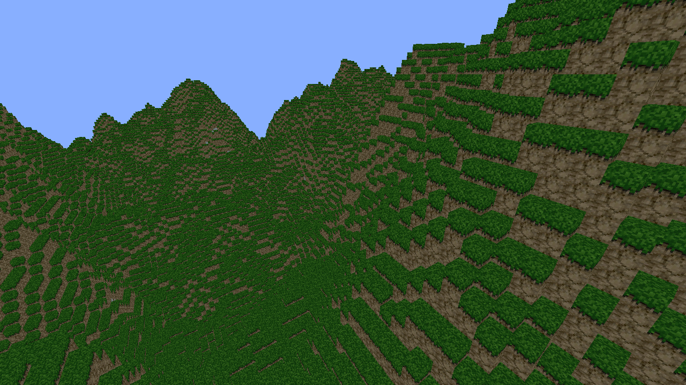
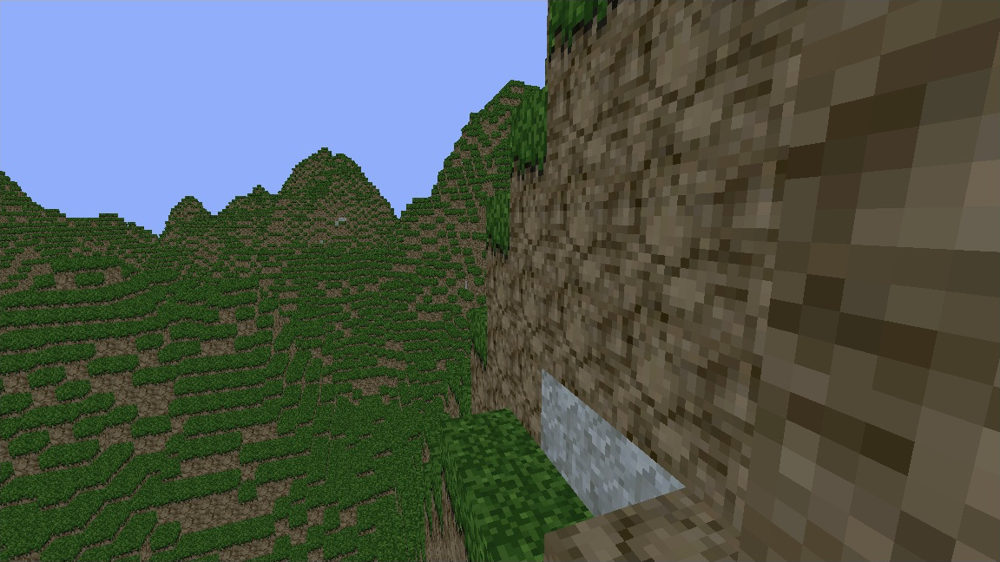

# Megalophobia

A personal voxel exploration prototype built in **Godot 4.6 with GDScript**. Explore procedural hills and caves, break blocks, and build with stone.

| Terrain overview | Hillside detail |
| --- | --- |
|  |  |

## Run it

Import `project.godot` into Godot 4.6, let the assets import, and press **F5**. The project uses Forward+ rendering and Jolt Physics. Nearby terrain loads gradually when the game starts.

**Controls:** WASD to move, mouse to look, Space to jump, Shift to sprint. Left-click removes a block; right-click places stone. **F3** toggles the debug HUD. **Escape** releases the cursor; restart the game to capture it again.

## Foundations

- **Procedural terrain:** fixed-seed noise generates the surface and underground caves, using grass, dirt, stone, and air.
- **Chunk-based world:** terrain is split into 16 × 16 × 16 chunks, stacked vertically. Chunks load and unload around the player.
- **Editable blocks:** a short raycast selects blocks for removal or placement. Each chunk stores block IDs in a flat packed array and provides a mesh for rendering and collision.

## Optimization

- **Greedy meshing** skips faces between solid blocks and merges matching neighboring faces into larger rectangles, reducing terrain geometry. See [chunk.gd](scripts/chunk.gd).
- **Texture atlasing** lets block types use one texture atlas. The [shader](shaders/voxel_atlas.gdshader) repeats tiles across merged faces so textures keep their block-sized pattern.
- **Budgeted streaming** loads nearby chunks first and spreads loading and unloading across frames. An extra unload radius reduces repeated loading at the boundary. See [chunk_streamer.gd](scripts/chunk_streamer.gd).
- **Background workers** generate voxels, meshes, and collision shapes. Results are applied on the main thread, with a limit on background rebuilds.
- **Priority edits** give block changes priority over background rebuilds. Repeated rebuild requests for the same chunk are combined, and revision checks reject outdated results. See [world.gd](scripts/world.gd).
- **Small saves** store edited block IDs instead of entire generated chunks. The base terrain is regenerated, then edits are reapplied. See [chunk_store.gd](scripts/chunk_store.gd).

Disk saving is **disabled in debug builds**: edits last only for that run. Release builds save under `user://chunks/`.

The default loading radius is 10 chunks, with one chunk spawned and up to two unloads attempted per frame. Background rebuilds are capped at eight; priority edits bypass that cap. Use F3 to inspect FPS, loaded chunks, and work queues while tuning these settings.
