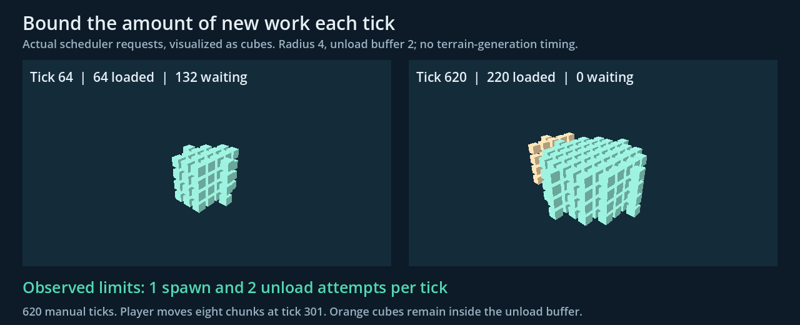
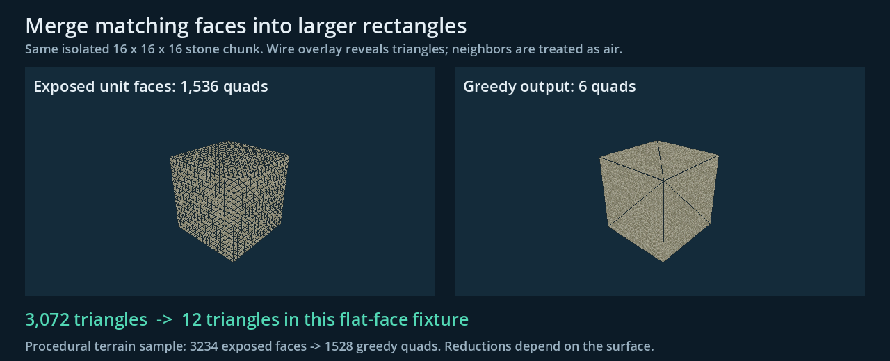
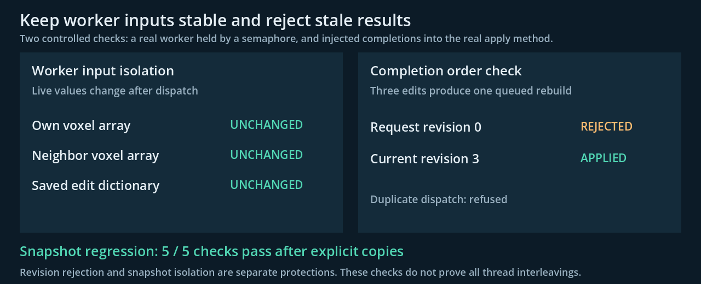
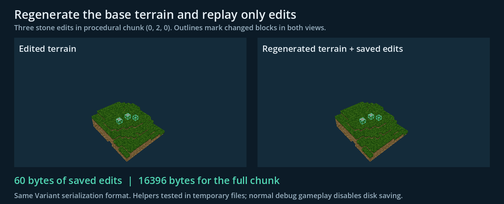

# Megalophobia technical case study

An independent voxel prototype in Godot 4.6 and GDScript. The engineering focus is deciding which work to do, reducing the amount of work, and keeping player edits consistent as background tasks finish.

[Repository](https://github.com/MindScrape/Megalophobia) | [Two-page PDF](../output/pdf/megalophobia-technical-case-study.pdf)

## Demonstrated engineering decisions

### 1 Stream terrain with bounded work

The world loads nearby 16 x 16 x 16 chunks first. Separate frame budgets spread loading and unloading over time; a wider unload radius reduces churn at the boundary. Background rebuilds have an eight-task limit, while player edits receive priority.



Scheduler fixture: 620 manual ticks, radius 4, and an eight-chunk move. The observed limits were one spawn and two unload attempts per tick. Terrain generation was excluded.

**Tradeoff:** Budgets bound request counts, not frame time. Failed unload retries are a known correctness issue in the current streamer.

Code: [Streaming](../scripts/chunk_streamer.gd), [Rebuild scheduling](../scripts/world.gd).

### 2 Reduce geometry before rendering

Greedy meshing merges adjacent faces with the same block type and orientation. The atlas shader repeats block textures across those larger rectangles. In one procedural chunk, 3,234 exposed unit faces became 1,528 merged quads. Surface shape determines how much can merge.



The isolated solid-chunk comparison uses the same outer surface: 1,536 unit quads versus six merged quads. This is a geometry reduction, not an FPS speedup.

**Tradeoff:** Caves and irregular surfaces merge less effectively. Edits currently rebuild the entire affected chunk, including collision.

Code: [Greedy sweeps](../scripts/chunk.gd), [Atlas shader](../shaders/voxel_atlas.gdshader).

### 3 Keep asynchronous edits consistent

A request now explicitly copies its own voxels, neighboring voxels, and saved edit data before entering the worker pool. A per-chunk guard rejects duplicate dispatch, and revision checks discard stale mesh results. Repeated edits share one pending rebuild entry.



A semaphore-controlled worker regression passes all five checks after the copy fix. Separately, injected completions show revision 0 rejected and revision 3 applied after three edits.

**Tradeoff:** Snapshot copies add allocation and main-thread work. These checks cover specific interleavings; worker lifecycle and shutdown still need hardening.

Code: [Async mesh path](../scripts/chunk.gd), [Snapshot regression](case-study/check_snapshot_isolation.gd).

### 4 Persist changes to a reproducible world

Fixed seeds regenerate the base terrain. Storage records edited voxel indices and replacement block IDs, then replays them on load. In a three-edit fixture, the saved dictionary occupied 60 bytes versus 16,396 bytes for the full chunk in the same serialization format. Reconstructed arrays matched exactly.



The storage helpers were exercised directly with temporary files. Normal debug gameplay disables disk saves; release-mode save and failure recovery are separate validation work.

**Tradeoff:** Save failures currently clear dirty state, and the edit cache has no eviction policy. Both are tracked in the engineering backlog.

Code: [Chunk storage](../scripts/chunk_store.gd), [Storage fixture](case-study/storage_fixture.gd).

## Measurements and reproduction

Controlled local fixtures on Apple M4, Godot 4.6.1-stable (official), debug build. The procedural sample at (-1, 1, 0) took 15.49 ms median and 15.72 ms p95 across 30 measured runs after three warmups. This times only the three greedy axis passes and output arrays; it excludes voxel generation, mesh upload, collision, and rendering.

These results cover controlled fixtures, not a gameplay frame-time or memory benchmark. The screenshots are instrumented Godot demonstrations generated from those results; the scheduler uses a request-recording world, and revision completion order is injected deliberately.

[Raw measurements](case-study/measurements.json), [snapshot checks](case-study/snapshot-isolation.json), and the [source manifest](case-study/source-manifest.json) identify the evidence. The source fingerprints identify the exact game files used by these fixtures. Regenerating the results after changing terrain or streaming settings will produce a new source manifest and may change the measurements.

From the repository root, using Godot 4.6.1:

```sh
godot --headless --path . --script docs/case-study/check_snapshot_isolation.gd
godot --headless --path . --script docs/case-study/measure.gd
godot --headless --path . --script docs/case-study/check_review_findings.gd
godot --path . --script docs/case-study/capture.gd --resolution 1280x520
python3 docs/case-study/build_document.py
```

The PDF builder uses ReportLab and Pillow, plus Arial fonts from macOS. Run the measurement step before the graphical capture; storage fixtures use disposable files under `/private/tmp/megalophobia-case-study/`.

## Remaining work

Next: empty-mesh handling, reliable unload retries, boundary-face ownership, complete task cleanup, and failed-save recovery. These are tracked with verification criteria in the engineering backlog.

[Prioritized engineering fixes](engineering-fixes.md)
